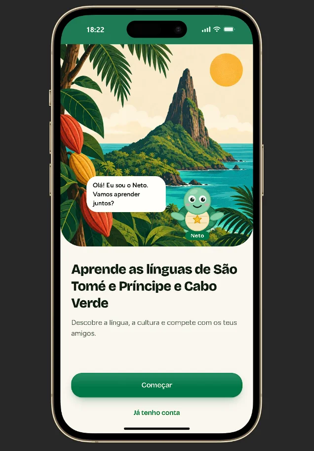
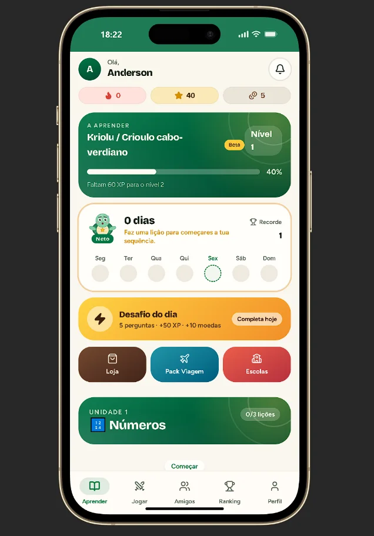
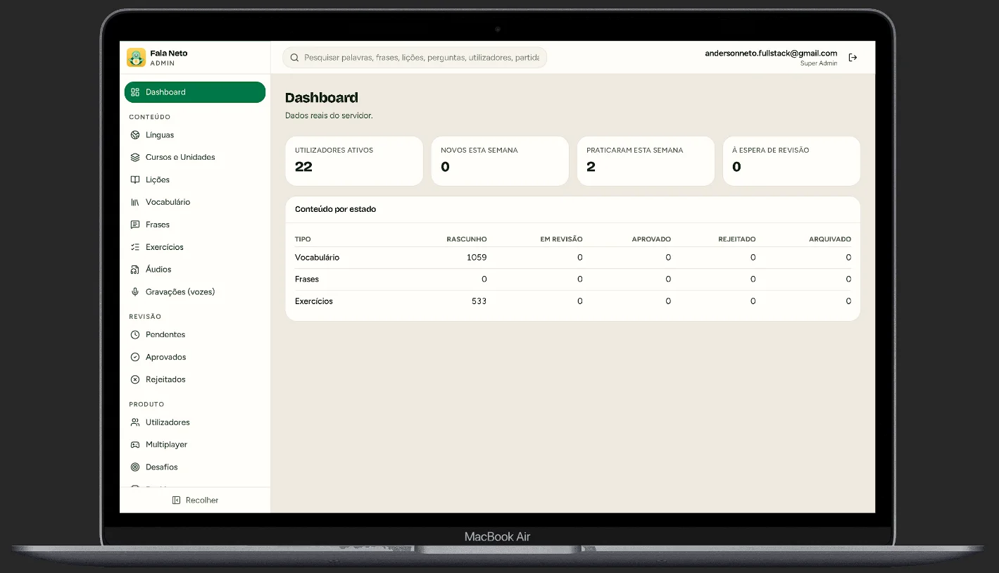
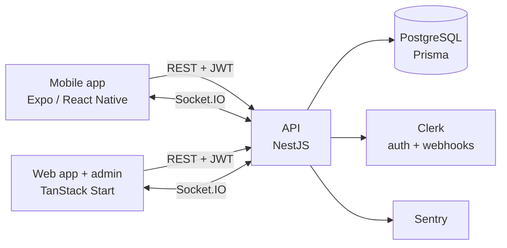

# Fala Neto

**Learn. Play. Preserve.** A mobile app to learn African languages, with gamified lessons, a daily challenge and a real-time multiplayer Arena.

It starts with Forro (São Tomé and Príncipe) and Kriolu (Cape Verde, beta), and is built so that new languages can be added without changing the app or the API.


> **Content rule:** no word, translation or pronunciation is invented. Sample content is a labelled placeholder until a native speaker approves it in the admin panel. AI suggestions always enter as `DRAFT`, and whoever creates content cannot approve it.

## Screenshots

| Welcome | Learn | Admin dashboard |
|---|---|---|
|  |  |  |

## Features

- **Lessons and courses:** units, lessons and exercises per language, with audio from native speakers and progress tracking.
- **Gamification:** XP, levels, coins, daily streak, achievements and a daily challenge.
- **Multiplayer Arena:** real-time quiz matches over Socket.IO (survival, 1v1 duel, 2v2 teams, private rooms by invite, match history).
- **Social:** friends, blocking and rankings.
- **Content workflow:** `DRAFT → UNDER_REVIEW → APPROVED / REJECTED`, with role-based permissions and an audit log. Only approved content reaches the app.
- **Voice contributions:** native speakers record words and phrases, and recordings are reviewed before publishing.
- **Admin panel:** languages, courses, vocabulary, phrases, exercises, audio, users, multiplayer and insights.
- **Internationalised UI:** Portuguese and English.

## Architecture



- **Server-authoritative:** the client never decides XP, coins, streak, lives, score, the correct answer, official time or the winner. Game rules live in a pure package (`@stp/game-engine`) shared by the server and tested in isolation.
- **Monorepo:** pnpm workspaces and Turborepo. Shared packages are consumed as TypeScript source, with no separate build step.
- **Data model:** 38 Prisma models, covering languages and variants, courses, review and audit, progress, economy, social and the Arena.

```text
apps/
  mobile/        Expo / React Native app (Expo Router, TanStack Query, Clerk)
  admin/         Web app and admin panel (TanStack Start, Radix UI, Tailwind)
  api/           NestJS API under /api/v1 (REST, Swagger, Socket.IO, Prisma)
packages/
  types/         Domain types and the multiplayer contract
  config/        Product values and feature flags (single source of truth)
  game-engine/   Pure Arena rules
  arena-client/  Typed Socket.IO client
  i18n/          UI translations (pt, en)
  tsconfig/      Shared strict TypeScript config
content/         External language data with source, licence and review state
docs/            Engineering plan, backend, deploy and business rules
```

## Tech stack

| Area | Technologies |
|---|---|
| Mobile | Expo, React Native, Expo Router, TanStack Query, i18next, Reanimated |
| Web / admin | React 19, TanStack Start, TanStack Router, Tailwind CSS, Radix UI |
| API | NestJS, Socket.IO, Prisma, PostgreSQL, Zod, Swagger, Pino, Helmet, Throttler |
| Auth | Clerk (JWT on REST and on the WebSocket handshake, user sync via webhooks) |
| Quality | Vitest, ESLint, Prettier, strict TypeScript, GitHub Actions |
| Ops | Docker (one Dockerfile per service), Railway, Neon, Sentry |

## Getting started

Requirements: Node.js 20+ and pnpm 10.

```bash
pnpm install
pnpm dev:admin      # web app + /admin at http://localhost:8080
pnpm dev:mobile     # Expo: press "w" for web or scan the QR code with Expo Go
pnpm dev:api        # API at http://localhost:3000/api/v1/health
```

Each app has its own `.env.example` (`apps/api`, `apps/admin`, `apps/mobile`). Only public keys go into these files.

## Tests and CI

114 automated tests (Vitest) cover game rules, content review, lesson and progress rules, daily challenges, auth guards, environment validation, routing and i18n.

```bash
pnpm lint
pnpm typecheck
pnpm test
pnpm build
```

GitHub Actions runs all four on every push and pull request to `main`.

## Status

The web app, the admin panel and the API are complete. The mobile app is being prepared for the Google Play release. Linguistic content is being reviewed by native speakers.

## Documentation

The project documentation is written in Portuguese.

| Document | Content |
|---|---|
| [docs/PLANO_DE_ENGENHARIA.md](docs/PLANO_DE_ENGENHARIA.md) | Engineering plan, ADRs, risks and the Google Play checklist |
| [docs/BACKEND.md](docs/BACKEND.md) | Services, hosting and environments |
| [docs/DEPLOY.md](docs/DEPLOY.md) | Deploying the API and web app with Docker on Railway |
| [docs/REGRAS_DE_NEGOCIO.md](docs/REGRAS_DE_NEGOCIO.md) | Business rules |
| [docs/MONETIZACAO.md](docs/MONETIZACAO.md) | Monetisation model |
| [CONTRIBUTING.md](CONTRIBUTING.md) | How to contribute |

## Author

**Anderson Neto**, Full-Stack Developer in Lisbon. [Portfolio](https://andersonneto.gt.tc) · [LinkedIn](https://linkedin.com/in/anderson-fullstack-developer)

## License

[MIT](LICENSE)
